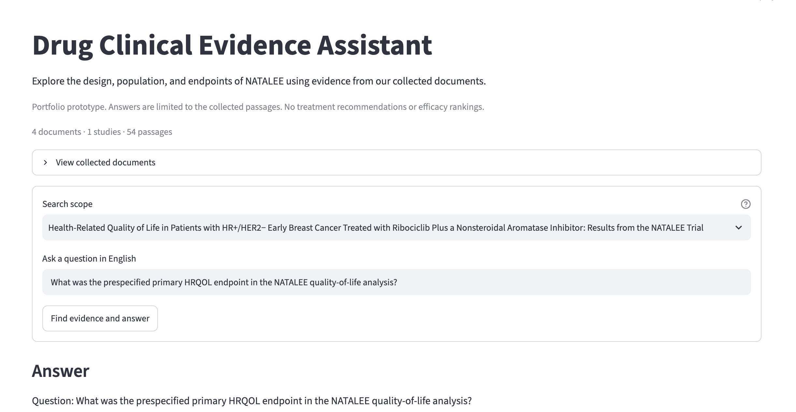
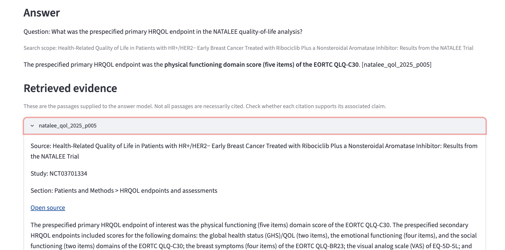

# Drug Clinical Evidence Assistant
## Project Report

### Why I built this

In my biostatistics work, answering a research question often starts with finding the right detail in a study document: the analysis population, endpoint definition, treatment schedule, or data cutoff date.

I wanted to build a small application that could retrieve those details and produce an answer with evidence that a reader could check. I chose the NATALEE trial because its design, outcomes, and quality-of-life publications offered different views of the same study.

The result is a local Streamlit application. Users can ask a question, search the full collection or select a document, and inspect the passages behind the answer.

This is a portfolio prototype. I have not tested it in a clinical workflow or measured whether it saves users time.

### What I included

The collection contains four documents and 54 selected passages, all linked to NATALEE (NCT03701334).

| Document | Content included |
| --- | --- |
| [FDA approval announcement, 2024](https://www.fda.gov/drugs/resources-information-approved-drugs/fda-approves-ribociclib-aromatase-inhibitor-and-ribociclib-and-letrozole-co-pack-early-high-risk) | Approval context, design, and reported results |
| [Study design paper, 2023](https://pmc.ncbi.nlm.nih.gov/articles/PMC10233570/) | Selected Methods text |
| [Four-year outcomes report, 2025](https://pmc.ncbi.nlm.nih.gov/articles/PMC12464853/) | Selected Methods and Results text |
| [HRQOL report, 2025](https://pmc.ncbi.nlm.nih.gov/articles/PMC12010963/) | Selected Methods, Results, and limitations |

I kept the collection small so I could inspect the extracted text and follow errors back to their source. Tables, figures, and supplementary materials are not included.

These are four documents about one study, not four independent studies. I used a shared study ID to keep that relationship explicit.

### How the application works

The application reads prepared passages, retrieves up to three candidates, and sends them with the question to an LLM. It then displays the answer and the supplied evidence.

I used natural paragraphs as the initial chunks. Each passage keeps its document ID, study ID, section, and paragraph ID. The document metadata provides the title and source URL.

This was straightforward to implement and inspect. The tradeoff is that some paragraphs are long and cover several topics. I have not yet compared this approach with sentence-based or fixed-length chunks.

The answer prompt asks the model to use only the supplied evidence and to say when it cannot answer. The application also saves the question, passages, prompt, model information, and response for later review.

The current interface supports:

- Free-text questions in English.
- Search across all documents or within one selected document.
- Answers with paragraph citations.
- Expandable source text.
- Run details and saved logs.

The paragraph IDs are local reference labels, not page numbers from the publications.

The screenshots below show the question-answering interface and an expanded source passage for checking the answer.

### What I tried for retrieval

I started with a simple keyword baseline and then added semantic and hybrid retrieval.

| Method | How it ranks passages |
| --- | --- |
| Keyword overlap | Counts distinct shared words after removing stopwords |
| Semantic search | Compares question and passage embeddings using cosine similarity |
| Hybrid search | Combines keyword and semantic rankings with reciprocal rank fusion |
| IDF-weighted keywords | Gives less common matched words more weight |

The semantic experiments used `text-embedding-3-small` with 1,536 dimensions. For hybrid search, I combined up to ten candidates from each method using an RRF constant of 60, then kept three results.

I expected semantic search to handle differently worded questions better. It helped on some questions, but it also returned passages that were related to the study without containing the requested detail.

To compare methods, I used labeled supporting paragraph IDs:

- **Hit@1:** Was the first result a labeled supporting passage?
- **Hit@3:** Did at least one labeled supporting passage appear in the first three results?

These measures check retrieval. They do not establish that the final answer is correct or that every necessary piece of evidence was retrieved.

#### Three-document check

With three documents, an additional check included six answerable questions and two unanswerable questions.

| Method | Hit@1 | Hit@3 |
| --- | --- | --- |
| Keyword overlap | 4/6 | 6/6 |
| Semantic search | 4/6 | 4/6 |
| Hybrid search | 4/6 | 5/6 |

Semantic search found useful treatment information, but it missed the labeled passages for the safety analysis population and overall survival maturity.

Hybrid search recovered one of these misses. However, for the overall survival question, combining the rankings pushed the supporting passage out of the final top three—even though keyword search had ranked it first.

That was a useful counterexample to my initial assumption that combining methods would necessarily improve retrieval.

#### After adding the HRQOL report

I then compared ordinary keyword matching with IDF weighting on a different development set: five answerable questions and one unanswerable question.

| Method | Hit@1 | Hit@3 |
| --- | --- | --- |
| Keyword overlap | 2/5 | 3/5 |
| IDF-weighted keywords | 1/5 | 3/5 |

IDF weighting brought the limitations passage into the top three, but it displaced the supporting passage for a question about questionnaires. The overall Hit@3 count stayed the same.

I kept ordinary keyword retrieval as the application default. It was easy to inspect, and these experiments did not provide a clear reason to replace it.

This decision applies to the current collection. The question sets are small, and the two tables use different questions and documents. They do not show that keyword retrieval is generally better.

I also added document selection. A user asking about the HRQOL report can restrict the search to that report, although this does not eliminate retrieval errors.

### Checking the generated answers

After selecting the retrieval approach, I ran eight questions through the answer pipeline. Six were scoped to specific documents; two unanswerable questions searched the full collection.

| Check | Result |
| --- | --- |
| Runs completed without execution errors | 8/8 |
| Answerable questions with labeled evidence retrieved | 5/6 |
| Answerable questions judged successfully answered in AI-assisted review | 5/6 |
| Unanswerable questions receiving an insufficient-evidence response | 2/2 |

I used AI-assisted review to compare the answers with their retrieved passages. That review found no obvious factual, numerical, or citation errors in the five substantive answers. Author confirmation is still pending.

Several questions had already been used during development, so I treat this as a regression check rather than an independent accuracy test.

One successful example asked for the primary HRQOL endpoint. The answer identified the physical functioning domain of the EORTC QLQ-C30 and cited the relevant passage. It did not confuse that endpoint with iDFS, the primary endpoint of the overall trial.

For a question about the percentage of participants with diabetes at baseline, the retrieved text did not contain an answer. The model reported insufficient evidence instead of supplying a percentage.

### A failure worth keeping

The application failed to answer:

> What was the data cutoff date for the NATALEE HRQOL analysis?

The date was present in `natalee_qol_2025_p013`, but that passage did not reach the top three results. This happened even when the search was restricted to the HRQOL document.

The model said the retrieved passages were insufficient.

I recorded this as a failed user task. The model did not invent a date, but the system still missed information that was available in its collection.

This case helped me separate two questions during evaluation:

1. Did retrieval supply the evidence needed to answer?
2. Did the model use the supplied evidence correctly?

Changing the answer prompt alone would not recover a passage that the model never received.

### Where my clinical research background helped

The most important checks were often about the meaning of a result rather than whether a number matched.

For example:

- The target hazard ratio in a sample-size calculation is not an observed treatment effect.
- The primary endpoint of an HRQOL analysis is not the primary endpoint of the overall trial.
- A planned three-year treatment course does not mean every patient completed three years.
- Publication date, data cutoff, and follow-up duration are different quantities.

These distinctions shaped the questions I tested and the details I checked in the answers. They also explain why I kept source passages visible instead of presenting the generated answer on its own.

### Current Status and Ongoing Improvements

The application runs locally using prepared passages and document metadata. The repository includes document preparation code, retrieval experiments, evaluation records, and the answer prompt. The default keyword pipeline does not require embeddings.

I am continuing to refine the system through retrieval experiments and review of failed answers. So far, I have compared four retrieval approaches and added document-level filtering. These changes have shown that improving one question can hurt another, so I check both recovered evidence and regressions before adopting a change.

My ongoing improvement priorities include:

- **Document processing:** Review passage boundaries and investigate splitting long paragraphs while preserving their section and source context.
- **Retrieval:** Evaluate document targeting, keyword and semantic methods, and candidate selection on the same question sets.
- **Answer quality:** Review whether responses preserve endpoint definitions, analysis populations, numerical context, and data cutoff dates.
- **Evaluation:** Add previously unused questions and distinguish retrieval failures from unsupported or incomplete answers.
- **Usability and reproducibility:** Improve evidence presentation, simplify setup, and verify installation in a clean environment.

Some of these improvements are still planned rather than implemented. I will report their effects only after evaluation.

The current limitations remain the selected document coverage, small evaluation sets, and missed evidence. AI-assisted answer review is awaiting author confirmation. The development environment passed `pip check`, but clean-environment installation has not yet been verified.

My goal is to make the application more useful and easier to verify while keeping a clear record of what works, what fails, and what each change actually improves.